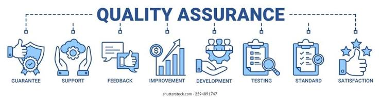
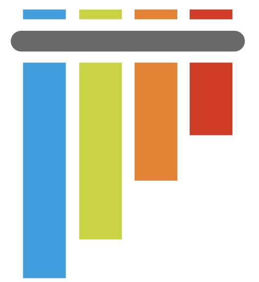
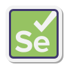

<td align="center" style="border: none; padding: 0 20px;">
     
</td>

# Здравствуйте! Меня зовут Сергей. 👋
### Junior QA Automation Engineer (Python) 🚀
## О себе:
🔭 Я — тестировщик, провожу ручное и автоматизированное тестирование на Python.
📚 Постоянно изучаю новые технологии, методы и инструменты, связанные с тестированием, чтобы быть в курсе последних тенденций и применять их на практике. В свободное время читаю книги для повышения уровня знаний.
🌱 Сейчас изучаю: CI/CD (GitHub Actions, Docker) и Playwright
## 🛠️ Мой стек автоматизации
<table align="left" style="border-collapse: collapse; border: none;">
  <tr style="border: none;">
    <!-- Столбец 1: Python -->
    <td align="center" style="border: none; padding: 0 20px;">
      
       - Python
      </a>
    </td>
    <!-- Столбец 2: Pytest -->
    <td align="center" style="border: none; padding: 0 20px;">
      
   - Pytest
      </a>
    </td>
    <!-- Столбец 3: Selenium -->
    <td align="center" style="border: none; padding: 0 20px;">
      
       - Selenium
      </a>
    </td>
   <!-- Столбец 4: Postgresql -->
    <td align="center" style="border: none; padding: 0 20px;">
      
     - Postgresql
      </a>
    </td>
   <!-- Столбец 5: Postman -->
    <td align="center" style="border: none; padding: 0 20px;">
      
   - Postman
      </a>
    </td>
   <!-- Столбец 6: Git -->
    <td align="center" style="border: none; padding: 0 20px;">
      
       - Git
      </a>
    </td>
   </tr>
</table>
 
 

## 📊 GitHub Stats
<!-- Блоки автоматической статистики кода (генерируются сами) -->

## 📂 Основные фреймворки автоматизации (примеры)
* **[Web-UI-Automation-Pytest](ссылка):** Фреймворк для UI-тестирования интернет-магазина. Использует **Python + Pytest + Selenium**. Реализован паттерн Page Object Model (POM), настроена генерация красивых отчетов **Allure Report**.
* **[API-Testing-Framework](ссылка):** Автоматизация тестирования REST API с использованием библиотеки `requests` и валидацией JSON-схем через `pydantic`.
### 📡 [REST-API-Testing-Framework](ссылка_на_ваш_репозиторий)
Автоматизация сквозного тестирования REST API.
* **Стек:** Python, Pytest, Requests, Pydantic (JSON Schema).
* **Что реализовано:**
  * Полноценное тестирование CRUD-операций (GET, POST, PUT, DELETE).
  * Строгая валидация типов данных и структуры ответов с помощью **Pydantic-моделей**.
  * Фикстуры Pytest для генерации динамических тестовых данных и автоматического управления авторизационными токенами (Bearer/Session).
    
##  💬 Связь со мной: 
*   Telegram: https://t.me\G_Sergey_V13].
*   LinkedIn: [ссылка].
*   Почта: serfre@mail.ru
*   

<!--
**Sergey-747/Sergey-747** is a ✨ _special_ ✨ repository because its `README.md` (this file) appears on your GitHub profile.

Here are some ideas to get you started:

- 🔭 I’m currently working on ...
- 🌱 I’m currently learning ...
- 👯 I’m looking to collaborate on ...
- 🤔 I’m looking for help with ...
- 💬 Ask me about ...
- 📫 How to reach me: ...
- 😄 Pronouns: ...
- ⚡ Fun fact: ...
-->
